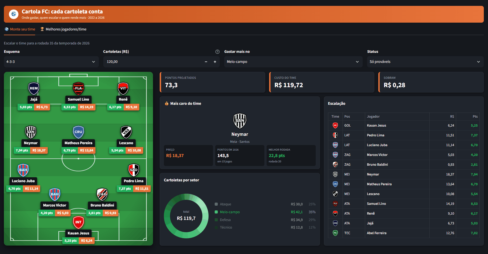
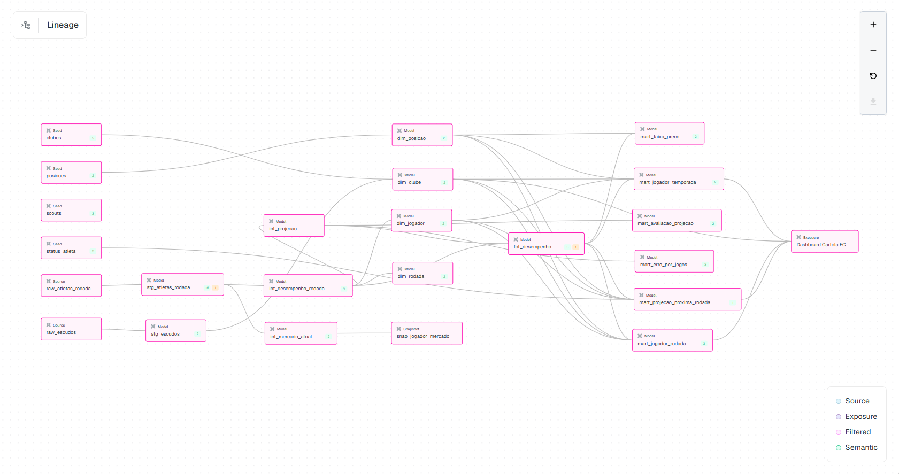

# ⚽ Cartola FC · Cada cartoleta conta (2022 a 2026)

**Vale mais escalar jogador barato ou caro? A "fase" do jogador ajuda a prever a próxima rodada?**
Pipeline de dados com cinco temporadas do Cartola FC: ingestão em Python, modelagem com **dbt** no **Snowflake** e dashboard em **Streamlit in Snowflake**.



---

## 📊 Principais resultados

| Indicador | Valor |
|---|---|
| Temporadas | **2022 a 2026** (até a rodada 34 de 2026) |
| Arquivos de rodada | **186** |
| Atletas | **2.427** |
| Jogos válidos analisados | **57.627** |

**1. Barato rende mais por cartoleta, mas é o caro que "mita".**

| Preço pago antes da rodada | Pontos por cartoleta | Média de pontos | Jogos com 10+ pontos |
|---|---|---|---|
| até C$ 5 | **0,684** | 2,40 | 3,5% |
| C$ 5 a 10 | 0,512 | 3,62 | 6,9% |
| C$ 10 a 15 | 0,419 | 4,90 | 12,0% |
| acima de C$ 15 | 0,353 | **6,14** | **20,9%** |

Cada cartoleta em jogador barato rende quase o dobro, mas um jogador acima de C$ 15 tem seis vezes mais chance de passar de 10 pontos. Por posição, **laterais** dão o melhor retorno (0,583 ponto por cartoleta) e **meias** o pior (0,472).

**2. A "fase" engana: os últimos jogos preveem pior que a média da temporada.**

Para cada jogo, calculei o que cada método teria previsto **usando só as rodadas anteriores** e medi o erro médio (em pontos, menor é melhor):

| Método | 2022 a 2025 | 2026 (teste) |
|---|---|---|
| Média do jogador na temporada (referência) | 2,879 | 3,036 |
| Média da posição | 2,886 | 3,035 |
| Últimos 3 jogos | 3,082 (**+7,1%**) | 3,289 (+8,3%) |
| Últimos 5 jogos | 2,952 (+2,5%) | 3,139 (+3,4%) |
| **Média do jogador puxada para a da posição (k = 5)** | **2,822 (−2,0%)** | **2,971 (−2,1%)** |

O método escolhido foi definido com 2022 a 2025 e **confirmado em 2026**, temporada que não foi usada na escolha. Ele mistura a média do jogador com a média da posição: com poucos jogos vale mais a posição, com muitos vale mais o próprio jogador.

**3. Destaques de 2025** (mínimo de 19 jogos):
- **Custo-benefício:** João Victor (Mirassol, 1,08 ponto por cartoleta), Lucas Halter (Vitória, 1,06) e André (Grêmio, 1,00). O Mirassol, estreante na Série A, teve 3 dos 5 primeiros.
- **Mais valorizados:** Souza (Santos, +C$ 7,46), Lucas Ramon (Mirassol, +C$ 7,04) e Guilherme (Santos, +C$ 6,82).
- **Mais regulares** (% de jogos com 5+ pontos): Kaiki Bruno (70%), William (69%) e Arrascaeta (69%).

> Jogo válido = o atleta entrou em campo e a pontuação da rodada é confiável (veja **Qualidade dos dados**). Técnicos ficam fora da avaliação das projeções.

---

## 🖥️ Dashboard

Duas abas em **Streamlit in Snowflake**:

- **⚽ Monte seu time:** monta num campo de futebol o time com mais pontos projetados para a rodada seguinte à última carregada. Escolha o esquema (4-3-3, 3-5-2…), quantas **cartoletas** quer gastar e em qual setor gastar mais (ataque, meio ou defesa). Mostra pontos, custo, sobra, cartoletas por setor, o jogador mais caro (com a melhor rodada dele) e a escalação.
- **🏆 Melhores jogadores/time:** escolha a temporada, uma rodada (ou todas) e o esquema. O campo mostra o melhor de cada posição, e o ranking lista os 10 melhores, ordenados por pontos, custo-benefício, valorização ou média.

---

## Arquitetura

```
caRtola (GitHub, CSV por rodada)
        │  Python (CSV → JSON por linha)
        ▼
  Stage interno  ──►  COPY INTO  ──►  dbt (staging → intermediate → marts + snapshot)  ──►  Streamlit
  (Snowflake)        (RAW VARIANT)    testes, unit test, contratos + Elementary              in Snowflake
```

| Camada | Ferramenta | O que faz |
|---|---|---|
| Ingestão | Python | Baixa os CSVs de cada rodada, converte para JSON por linha e envia ao stage (autenticação por par de chaves) |
| Armazenamento | Snowflake (stage + RAW) | Carrega com `COPY INTO` numa coluna `VARIANT`, guardando o arquivo de origem |
| Processamento | Snowflake (warehouse XSMALL) | Auto-suspend de 60 s e resource monitor para controlar o custo |
| Transformação | dbt Core + dbt-snowflake | Camadas, macros, modelo incremental, snapshot, testes e documentação |
| Qualidade | Elementary | Relatório de testes e lineage |
| Visualização | Streamlit in Snowflake | Dashboard em duas abas: escalação da próxima rodada (com orçamento) e melhores jogadores por temporada ou rodada |

### Star Schema

- **Fato:** `fct_desempenho` (atleta × rodada, **incremental**)
- **Dimensões:** `dim_jogador`, `dim_clube`, `dim_posicao`, `dim_rodada` (a fonte não tem datas: o tempo é temporada × rodada)
- **Marts:** `mart_jogador_temporada`, `mart_jogador_rodada`, `mart_faixa_preco`, `mart_avaliacao_projecao`, `mart_erro_por_jogos`, `mart_projecao_proxima_rodada`
- **Snapshot:** `snap_jogador_mercado` (histórico de clube, preço e status, SCD tipo 2)



### Recursos do dbt usados

| Recurso | Onde |
|---|---|
| **Macros com Jinja** | `campo_json` (lê e tipa campos do JSON), `normalizar_posicao` (loop num dicionário), `lista_scouts` |
| **Loops** | os 21 scouts são lidos e convertidos de acumulado para "por rodada" com `` |
| **Variáveis** | `k_shrinkage`, `min_jogos_ranking`, `temporada_atual`, lista de scouts |
| **Modelo incremental** | `fct_desempenho` com `merge`: rodada nova entra sem recalcular tudo |
| **Snapshot** | `snap_jogador_mercado` (estratégia `check` em clube, preço e status) |
| **Unit test** | `projecao_usa_so_rodadas_anteriores`: garante que a projeção não "vê" o resultado |
| **Contratos** | `mart_jogador_temporada` e `mart_projecao_proxima_rodada` com tipos garantidos |
| **Exposure** | o dashboard declarado como consumidor dos marts (aparece no lineage) |
| **Seeds** | clubes, posições, status e scouts |
| **Pacotes** | `dbt_utils` e `elementary` |

---

## Ingestão

A ingestão é feita por scripts Python em `ingestion/` e por SQL em `sql/`, executados **nesta ordem**:

| # | Script | O que faz |
|---|---|---|
| 1 | `sql/01_setup.sql` | Cria o warehouse XSMALL com auto-suspend, o resource monitor, o database `CARTOLA`, os schemas e a role `CARTOLA_DEV` |
| 2 | `ingestion/baixar_cartola.py` | Baixa os CSVs de cada rodada do repositório caRtola e converte para JSON por linha |
| 3 | `sql/02_stage.sql` | Cria o formato de arquivo JSON e o stage interno |
| 4 | `ingestion/enviar_stage.py` | Envia os arquivos para o stage com `PUT` (compacta em `.gz` e pula o que já foi enviado) |
| 5 | `sql/03_carga.sql` | Cria a tabela RAW e carrega com `COPY INTO` |
| 6 | `ingestion/carregar_escudos.py` | Baixa os escudos da API do Cartola e grava numa tabela (o app não acessa a internet) |
| 7 | `sql/04_encerramento.sql` | Suspende o warehouse e mostra os créditos gastos |

```
uv run python ingestion/baixar_cartola.py
uv run python ingestion/enviar_stage.py
```

**Organização no stage:**

```
@CARTOLA.RAW.STG_CARTOLA/
└── rodadas/temporada=AAAA/rodada-NN.json.gz
```

- **Por que JSON e não CSV?** A ordem e a quantidade de colunas mudam a cada temporada (scouts novos, campos que somem). Em JSON cada valor carrega o nome da coluna, a RAW aceita tudo numa `VARIANT` e o dbt escolhe os campos pelo nome.
- **Só o necessário:** nome completo, foto e slug dos atletas não são carregados.
- **Idempotente:** arquivos já baixados ou enviados são pulados. Quando sai uma rodada nova, basta rodar de novo e o `fct_desempenho` (incremental) recebe só as linhas novas.
- **Rastreável:** cada linha guarda o arquivo de origem (`METADATA$FILENAME`) e a hora da carga.

---

## ✅ Qualidade dos dados

A fonte tem armadilhas que mudam o resultado se passarem despercebidas:

| Problema na fonte | Como foi tratado |
|---|---|
| O arquivo `rodada-N` é a foto **depois** da rodada: pontos são da rodada, mas jogos, média e scouts são **acumulados** | Scouts e jogos da rodada saem da diferença para o arquivo anterior (`lag`), com um loop de Jinja |
| `rodada-1` de 2022 e de 2025 é foto de **pré-temporada** (ninguém jogou) e o de 2023 informa rodada 2 com pontos zerados | Arquivo marcado como inválido (`pontos_validos = false`); jogos e média da temporada usam os números oficiais |
| Posição como texto (`gol`, `lat`...) em parte de 2022 | Macro `normalizar_posicao` |
| `entrou_em_campo` não existe em 2022 e falta em parte de 2023 | Regra: o total de jogos aumentou em relação ao arquivo anterior |
| Nome do clube em três formatos, inclusive com acentuação quebrada ("São Paulo") | Só o `clube_id` da fonte + seed de clubes |
| Ordem e conjunto de colunas diferentes a cada ano | JSON + `VARIANT` na RAW |

- **66 testes dbt em todas as camadas** (65 de dados + 1 unit test, 0 erros): `unique`, `not_null`, `relationships`, `accepted_values`, `accepted_range`, `unique_combination_of_columns`, **unit test** da projeção e testes singulares (soma do mart igual à fato, um arquivo por rodada, projeção dentro do intervalo possível). Problemas conhecidos da fonte ficam como `warn`.
- **Validação contra o número oficial:** a média recalculada com os jogos válidos bate com a média do Cartola (±0,05) em **95,9%** dos atletas em 2024 e **96,9%** em 2026 (temporadas com a rodada 1 válida).
- **Elementary:** [relatório de testes e lineage](https://natmartines.github.io/cartola-fc/elementary/) (0 erros; 2 avisos esperados da fonte).

---

## 🧭 Decisões principais

- **Preço pago, não preço final:** o custo-benefício usa o preço **antes** da rodada (`preço − variação`), que é o que o cartoleiro realmente paga.
- **Somas no mart, razões no dashboard:** pontos por cartoleta e % de jogos com 10+ pontos são recalculados a partir das somas, com qualquer filtro.
- **Mínimo de 19 jogos** (meia temporada) nos rankings, para um jogador com 3 boas rodadas não aparecer no topo por acaso.
- **Projeção sem vazamento:** cada previsão usa só rodadas anteriores (janela `rows between unbounded preceding and 1 preceding`), e o unit test garante isso.
- **Método simples e explicável** em vez de um modelo de machine learning: o objetivo era mostrar, com dados, que a média é melhor que a "fase".
- **Sem mando de campo e adversário:** a fonte não traz as partidas depois de 2016.

Todas as decisões estão em [`docs/decisoes.md`](docs/decisoes.md).

---

## 💰 Custo

Warehouse **XSMALL** com auto-suspend de 60 s e **resource monitor** de 10 créditos.

Custo total do projeto: **cerca de 12 créditos**. O pipeline (ingestão, dbt, testes e consultas no `WH_CARTOLA`) gastou só **0,78 crédito**; o restante (~11 créditos, mais de 90%) foi do app Streamlit, que roda num container e consome enquanto está aberto. Detalhes em [`docs/decisoes.md`](docs/decisoes.md).

---

## 🤖 Uso de IA

Defini as perguntas, as regras de negócio, os tratamentos de qualidade e o layout e, a partir dessas especificações, usei o **Claude Code** para gerar o código. Reaproveitei as skills criadas no projeto [Voos ANAC](https://github.com/NatMartines/voos-anac), versionadas em `.claude/skills/`:

| Skill | Para que serve |
|---|---|
| [`dashboard-streamlit-snowflake`](.claude/skills/dashboard-streamlit-snowflake/SKILL.md) | Padrão visual, regras de cálculo e armadilhas para dashboards em Streamlit in Snowflake |
| [`documentar-tabelas-dbt`](.claude/skills/documentar-tabelas-dbt/SKILL.md) | Documentação dos modelos dbt em português (schema.yml, testes e dicionário) |

---

## ⚠️ Limitações

- A rodada 1 de 2022, 2023 e 2025 não tem arquivo válido: os pontos dessa rodada ficam fora das análises rodada a rodada (jogos e média da temporada usam os números oficiais).
- Na rodada 2 de 2022 e 2025, os scouts incluem também a rodada 1.
- Sem dados de partida (mandante, adversário) depois de 2016.
- 2026 ainda está em andamento (até a rodada 34 na última carga).
- A API do Cartola traz escudos simplificados e não tem imagem para 10 clubes; esses aparecem com uma bolinha nas cores do clube.
- Os preços aparecem como R$ no dashboard, mas no jogo são cartoletas (C$), a moeda do Cartola.
- O app do Streamlit in Snowflake **não é público**: o resultado está no GIF acima.

---

## 🛠️ Tecnologias

`Python` · `uv` · `Snowflake` · `dbt` · `dbt_utils` · `Elementary` · `Streamlit` · `Altair` · `Git`

---

## ▶️ Como rodar

1. Crie uma conta no Snowflake e siga a ordem da seção **Ingestão**.
2. Instale as dependências e configure o `.env` a partir do `.env.example`:
```bash
   uv sync
```
3. Construa os modelos, o snapshot e rode os testes:
```bash
   cd cartola_dbt
   uv run dbt deps
   uv run dbt build
```
4. Gere o relatório de qualidade:
```bash
   uv run edr report --profile-target cartola
```

**Dashboard:** no Snowsight, crie um app Streamlit e envie os arquivos da pasta `app/` (`streamlit_app.py` e `.streamlit/config.toml`).

---

## Estrutura do repositório

```
cartola-fc/
├── ingestion/           # download do caRtola (CSV → JSON) e envio ao stage
├── sql/                 # setup, stage, carga (COPY INTO) e encerramento
├── cartola_dbt/         # projeto dbt
│   ├── models/
│   │   ├── staging/
│   │   ├── intermediate/
│   │   └── marts/       # fato, dimensões, marts e exposure
│   ├── snapshots/       # histórico do mercado (SCD 2)
│   ├── seeds/           # clubes, posições, status e scouts
│   ├── tests/           # testes singulares
│   ├── macros/
│   └── analyses/        # consultas de exploração
├── app/                 # dashboard Streamlit in Snowflake
├── docs/                # decisões, imagens e relatório Elementary
└── .claude/skills/      # skills de IA reaproveitadas
```

---

## Fonte dos dados

- **[caRtola](https://github.com/henriquepgomide/caRtola)**, de Henrique Gomide e colaboradores (licença MIT): arquivos por rodada com os dados públicos do mercado do Cartola FC, em `data/01_raw/{ano}/rodada-N.csv`.
- Cartola FC é um produto da Globo. Este é um projeto de estudo, sem relação com a Globo.